# Manual do VEE Rádio

O VEE Rádio transforma um telemóvel Android antigo numa rádio que toca estações da internet, ligada a uma coluna ou aparelhagem. Controlas a rádio a partir do browser de qualquer telemóvel ou computador, através de um link que a rádio te envia quando arranca.

Este manual explica como instalar a rádio no telemóvel e como usar o comando no dia a dia.

> As imagens mostram o comando com rádios de exemplo. No teu telemóvel aparecem as tuas playlists e as tuas rádios.

## Índice

1. [Do que precisas](#1-do-que-precisas)
2. [Instalação](#2-instalação)
3. [Arrancar e receber o link](#3-arrancar-e-receber-o-link)
4. [Usar o comando](#4-usar-o-comando)
5. [Playlists](#5-playlists)
6. [Configurações](#6-configurações)
7. [Parar, atualizar e cópias de segurança](#7-parar-atualizar-e-cópias-de-segurança)
8. [Problemas comuns](#8-problemas-comuns)
9. [Resumo dos comandos](#9-resumo-dos-comandos)

## 1. Do que precisas

- Um telemóvel Android que fique ligado à corrente e à coluna. É este telemóvel que toca a música.
- Ligação à internet por Wi-Fi.
- A loja de apps [F-Droid](https://f-droid.org), para instalar:
  - o [Termux](https://f-droid.org/packages/com.termux/), onde a rádio corre;
  - o [Termux:Boot](https://f-droid.org/packages/com.termux.boot/), para a rádio arrancar sozinha quando o telemóvel liga.

> Instala o Termux do F-Droid, não da Play Store: a versão da Play Store está desatualizada e não funciona. O Termux e o Termux:Boot têm de vir da mesma loja.

## 2. Instalação

### 2.1 Instalar a rádio

1. Abre o **Termux**.
2. Escreve este comando e carrega em Enter:

   ```bash
   curl -sL https://raw.githubusercontent.com/vitor-gsousa/vee-radio/main/install.sh | bash
   ```

3. Quando o Android pedir acesso ao armazenamento, **aceita**. A rádio usa-o para guardar as cópias de segurança.
4. Espera até aparecer `=== Instalação concluída! ===`. Na primeira vez pode demorar vários minutos, porque se instalam todos os programas de que a rádio precisa.

Podes voltar a correr o mesmo comando sempre que quiseres: atualiza a instalação e não apaga as tuas playlists.

### 2.2 Arranque automático

Para a rádio arrancar sozinha sempre que o telemóvel liga:

1. Instala o **Termux:Boot** do F-Droid.
2. Abre o Termux:Boot **uma vez**. Sem isso, o Android não o deixa correr no arranque.
3. Nas definições do Android, em **Bateria** (ou **Apps** → Termux → Bateria), desativa a otimização de bateria para o **Termux** e para o **Termux:Boot**. Sem isto, o Android pode fechar a rádio passado algum tempo.

Daí em diante, quando ligas o telemóvel, a rádio atualiza-se, arranca e envia-te o link.

### 2.3 Android 12 ou mais recente (opcional)

A partir do Android 12, o sistema pode fechar programas do Termux que estejam a correr em segundo plano. Se a rádio parar sozinha de vez em quando, liga o telemóvel a um computador com a depuração USB ativa e corre no computador:

```bash
adb shell device_config put activity_manager max_phantom_processes 2147483647
```

## 3. Arrancar e receber o link

### 3.1 Arrancar à mão

Se não usas o arranque automático, ou se a rádio estiver parada, abre o Termux e escreve:

```bash
~/start.sh
```

A rádio arranca e volta a tocar a última playlist. Depois disso podes fechar o Termux, que a rádio continua a tocar.

### 3.2 O link do comando

Quando a rádio arranca, cria um link público, do género `https://palavras-ao-acaso.trycloudflare.com`. É esse link que abre o comando em qualquer telemóvel ou computador.

- **O link muda sempre que a rádio arranca.** Os links antigos deixam de funcionar.
- **Quem tiver o link controla a rádio.** Envia-o só a quem quiseres.

Há três maneiras de o receber:

| Maneira | Como funciona |
| --- | --- |
| Página de partilha | Abre-se sozinha no próprio telemóvel da rádio, com os botões **Copiar link** e **Partilhar…** |
| Notificação ntfy | O link chega como notificação à app ntfy no teu telemóvel. Toca na notificação para abrir o comando |
| Microsoft Teams | O link chega como cartão a um chat ou canal do Teams, com a data e hora do arranque e o botão **Abrir comando** |

Se não configurares o ntfy nem o Teams, ou se o envio falhar, abre-se a página de partilha:

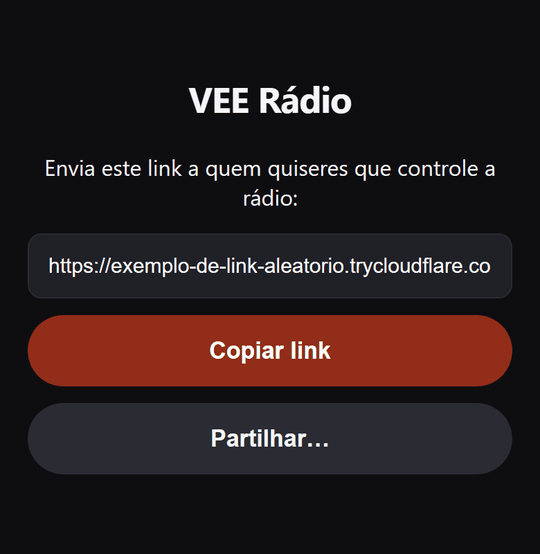

O ntfy e o Teams configuram-se nas [Configurações](#6-configurações), separador **Acesso**.

#### Receber por ntfy

1. Instala a app **ntfy** no teu telemóvel (Play Store, F-Droid ou App Store).
2. Na app, subscreve um tópico com um nome difícil de adivinhar, por exemplo `radio-72f7dd80db7f4f5d`. Quem souber o nome do tópico recebe o link.
3. Escreve o mesmo nome nas Configurações, em **Tópico do ntfy**.

#### Receber no Teams

É preciso uma conta profissional ou escolar em que os Workflows (Power Automate) estejam permitidos.

1. No Teams, abre os **Workflows** e escolhe o modelo **"Send webhook alerts to a chat"** (ou **"… to a channel"**).
2. Escolhe um chat só teu ou um canal privado: quem lá estiver recebe o link.
3. Copia o endereço `https://...` que o modelo te dá e cola-o nas Configurações, em **Webhook do Teams**.

O endereço do webhook é uma credencial: quem o tiver consegue escrever nesse chat. Não o partilhes.

Cada cartão mostra a data e hora do arranque, e só o link mais recente funciona. Para o mais recente ficar sempre à vista, usa um canal só para isto com as respostas desligadas, ou fixa o chat.

### 3.3 Usar só em casa, sem link público

Se só quiseres controlar a rádio no próprio telemóvel ou na rede Wi-Fi de casa, desliga **Acesso pela internet** nas Configurações. A rádio deixa de criar o link e abre o comando no browser do telemóvel. Nos outros aparelhos da mesma rede, abre `http://<IP-do-telemóvel>:8080`. O IP vem nas definições de Wi-Fi do Android.

## 4. Usar o comando

No telemóvel, o comando tem três separadores em baixo: **Início**, **Descobrir** e **Playlists**. O reprodutor fica sempre por cima deles.

### 4.1 Início

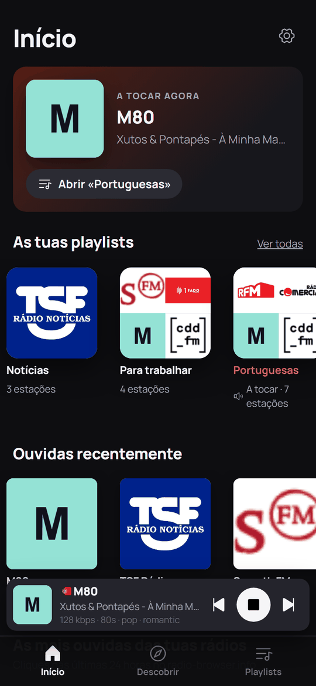

O Início é um resumo:

- **A tocar agora:** a rádio e a música que está a tocar. Toca no cartão para abrir o reprodutor, ou em **Abrir «…»** para ver a playlist.
- **As tuas playlists:** toca numa para a abrir.
- **Ouvidas recentemente:** as últimas rádios que tocaram pelo menos 20 segundos. Toca numa para a ouvir outra vez.
- **As mais ouvidas das tuas rádios** e **Em alta:** destaques das tuas rádios, segundo o radio-browser.info. Podem demorar a aparecer na primeira visita.

O botão ⚙ no canto, que abre as Configurações, só aparece no próprio telemóvel da rádio.

### 4.2 Reprodutor

O reprodutor mostra a rádio, a música, a qualidade e os géneros, e tem os botões ⏮ (rádio anterior), ▶/⏹ (tocar ou parar) e ⏭ (rádio seguinte).

Toca no nome da rádio para abrir o reprodutor completo:


- **Volume:** arrasta a barra, ou usa os botões nas pontas.
- **🌐 Site:** abre o site da rádio.
- **♡ Votar:** dá um voto à rádio no radio-browser.info. O número ao lado é o total de votos. Só conta um voto na mesma rádio a cada 10 minutos.
- **Qualidade:** se a rádio tiver várias versões (por exemplo, "128 kbps ▾"), escolhe aqui a que preferes. A escolha fica guardada na playlist.
- **Mostrar na lista:** abre a playlist e destaca a rádio.
- **Mudar o logótipo:** mostra os logótipos encontrados para a rádio. Escolhe um, cola o endereço de outra imagem, ou carrega em **Automático** para voltar ao que a rádio encontra sozinha.

Se a ligação a uma rádio cair, o comando volta a tentar até 5 vezes e mostra "A voltar a ligar… (tentativa 2 de 5)". Se não conseguir, passa para outra versão da mesma rádio (quando há) ou para e avisa. Nesse caso, ▶ tenta outra vez.

### 4.3 Descobrir

Em Descobrir encontras rádios novas no [radio-browser.info](https://www.radio-browser.info), um catálogo com rádios de todo o mundo. Há três maneiras de procurar: **Nome**, **Temas** e **Países**.

<p>
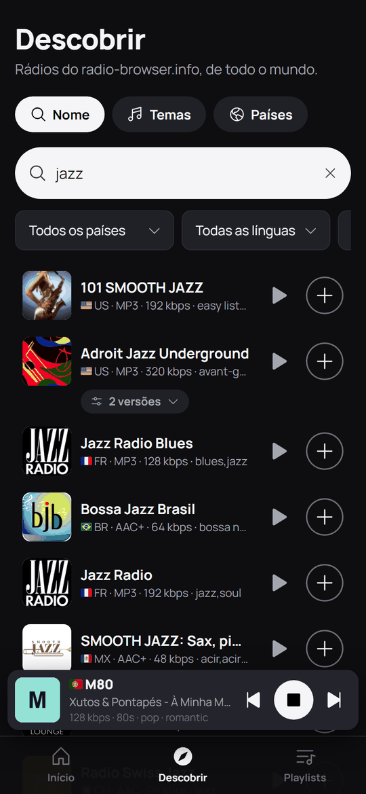
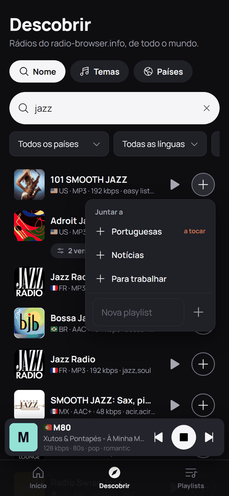
</p>

**Procurar pelo nome:** escreve o nome da rádio. Os resultados aparecem enquanto escreves. Os filtros por baixo (país, língua, qualidade mínima e ordem) aplicam-se logo.

Em cada resultado:

- **▶ Experimentar:** ouve a rádio sem a guardar. O reprodutor mostra "A experimentar" e um botão **+ Juntar** para a guardar na playlist que está a tocar.
- **+ Juntar:** abre a lista das tuas playlists. Escolhe onde queres juntar a rádio. As que já a têm mostram ✓. Juntar a uma playlist que não está a tocar não muda a música.
- **Nova playlist:** no fim desse menu, escreve um nome para criar uma playlist nova já com essa rádio.
- **N versões:** a mesma rádio em várias qualidades. O ▶ e o + usam a melhor; abre o botão para escolher outra.

**Juntar pelo endereço do stream:** se já sabes o endereço da rádio (por exemplo, `https://.../stream.mp3`), abre esta secção, escreve o endereço e um nome, e escolhe a playlist.

<p>
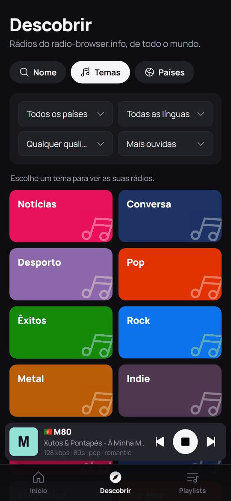
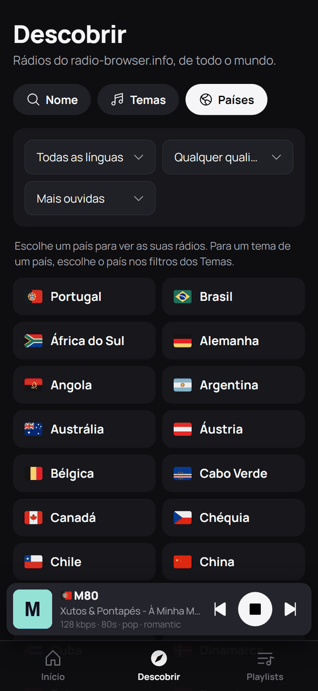
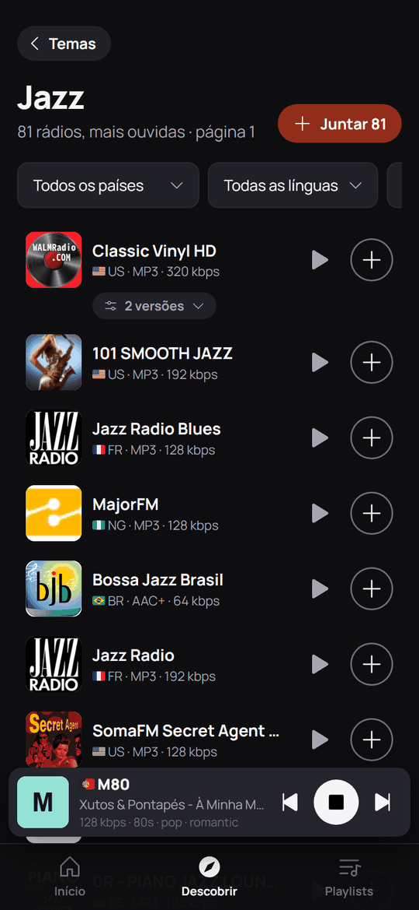
</p>

**Temas e Países:** toca num tema (Notícias, Pop, Rock, Jazz, Fado…) ou num país para ver as suas rádios. Para ver um tema de um só país, escolhe o tema e depois o país nos filtros.

Nos resultados de um tema ou país, o botão **+ Juntar** no topo junta todas as rádios da página de uma vez: à playlist que está a tocar, a outra que escolhas, ou a uma playlist nova com o nome do tema.

Os resultados vêm em páginas de 100. No fim da página, **Seguintes** mostra as próximas.

## 5. Playlists

Uma playlist é uma lista de rádios. A que está a tocar chama-se playlist ativa. Tudo o que juntas ou removes fica guardado logo, sem botão de guardar.

### 5.1 Lista de playlists

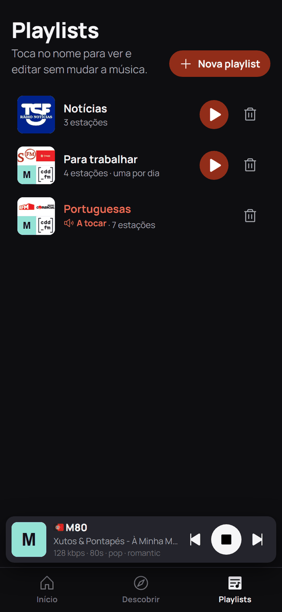

- **Toca no nome** para abrir a playlist. A música não muda.
- **▶** passa essa playlist a tocar. A rádio que está a tocar não é cortada: continua até escolheres outra.
- **🗑** apaga a playlist, depois de confirmares.
- **+ Nova playlist** cria uma playlist nova (ver abaixo).

### 5.2 Página de uma playlist

<p>
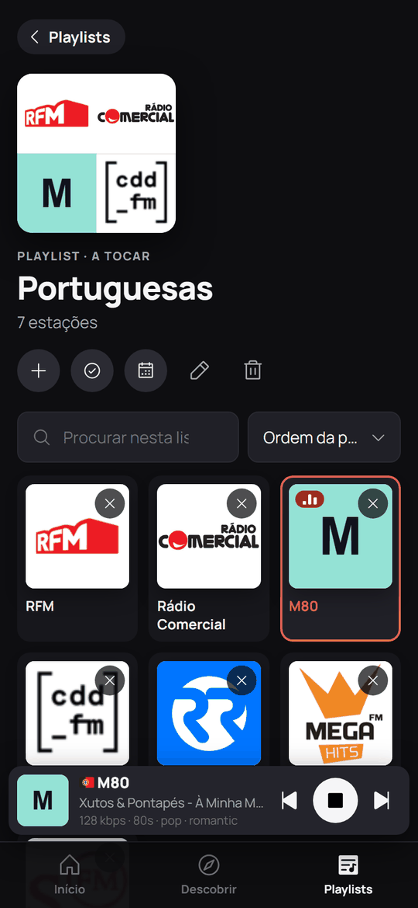
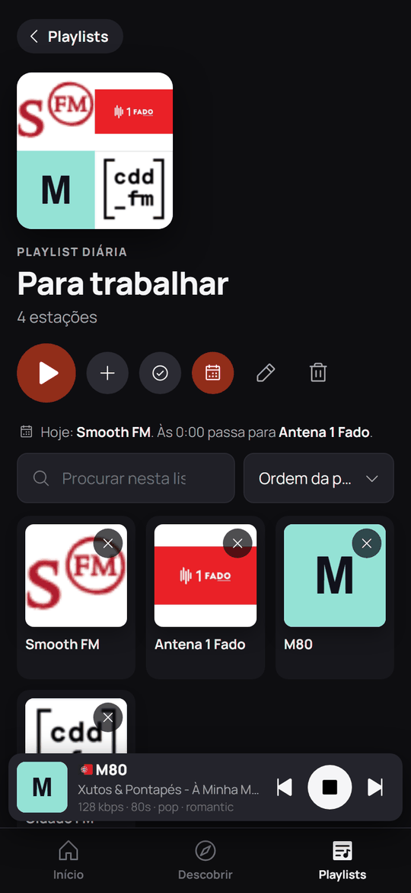
</p>

As rádios aparecem em cartões com o logótipo.

- **Toca num cartão** para ouvir essa rádio. Se a playlist ainda não estava a tocar, passa a tocar a partir daí, e ⏮ ⏭ seguem-na.
- **✕** remove a rádio da playlist. Durante 2 minutos aparece um botão **Anular** para a repor.
- **Procurar nesta lista** filtra as rádios pelo nome enquanto escreves.
- **Ordem da playlist** muda a ordem em que as vês: mais ouvidas, mais votadas, em alta ou de A a Z. Só muda o que vês; ⏮ ⏭ seguem sempre a ordem da playlist.

Os botões no topo:

No telemóvel aparecem só os ícones; no computador, também os nomes.

| Botão | O que faz |
| --- | --- |
| ▶ | Põe esta playlist a tocar (só aparece se não for a que está a tocar) |
| + Juntar rádios | Abre Descobrir para juntar rádios a esta playlist |
| ✓ Selecionar | Escolher várias rádios para copiar, mover ou remover (ver [5.5](#55-copiar-mover-ou-remover-várias-rádios)) |
| 📅 Uma por dia | Liga ou desliga a playlist diária (ver [5.4](#54-playlist-diária-uma-por-dia)) |
| ✏ | Mudar o nome |
| 🗑 | Apagar |

### 5.3 Criar uma playlist

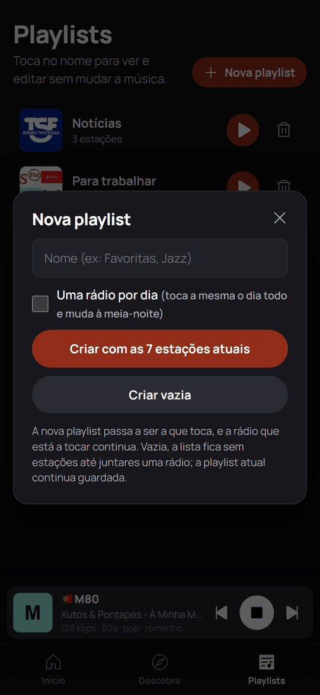

Em **+ Nova playlist**, escreve o nome e escolhe:

- **Criar com as N estações atuais:** uma cópia da playlist que está a tocar, para depois tirares as que não queres.
- **Criar vazia:** uma playlist sem rádios, para juntares as que quiseres em Descobrir.

A playlist nova passa a ser a que toca. A rádio que está a tocar continua.

### 5.4 Playlist diária ("Uma por dia")

Uma playlist diária toca a mesma rádio o dia todo e, à meia-noite, passa para a seguinte da lista. Quando chega ao fim, volta à primeira. A página diz qual é a rádio de hoje e qual vem a seguir.

- Liga-se com o botão 📅 na página da playlist, ou com **Uma rádio por dia** ao criá-la.
- Se escolheres outra rádio durante o dia, o dia seguinte começa na que vem depois dela.
- Se a rádio estiver parada à meia-noite, não começa a tocar sozinha. O ▶ toca a rádio do novo dia.

### 5.5 Copiar, mover ou remover várias rádios

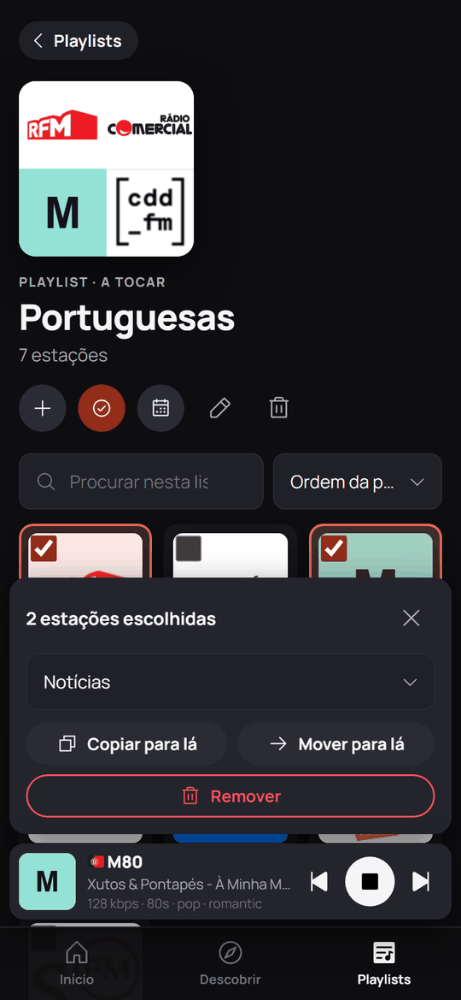

1. Na página da playlist, carrega em **✓ Selecionar**.
2. Toca nas rádios que queres. A barra em baixo mostra quantas escolheste.
3. Escolhe a playlist de destino e carrega em **Copiar para lá** ou **Mover para lá**, ou carrega em **Remover**.
4. **✕** na barra sai do modo de seleção.

### 5.6 No computador

No computador, o comando mostra as playlists numa barra à esquerda e o reprodutor numa barra em baixo, com o volume sempre à vista.

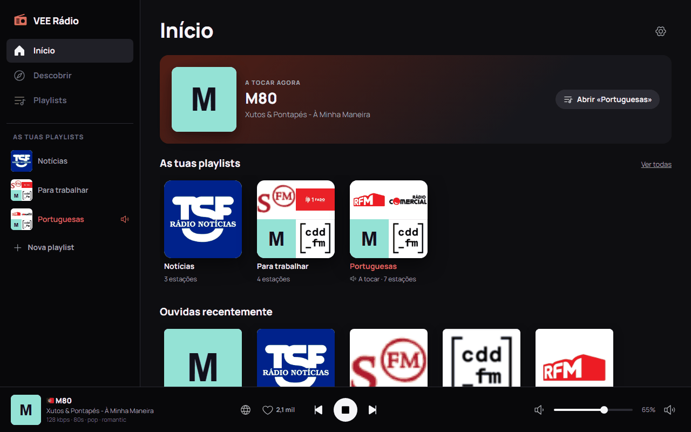

## 6. Configurações

As Configurações só abrem **no próprio telemóvel da rádio**. Quem tem o link não as vê, para ninguém conseguir desviar os links para outro lado.

Para as abrir, corre no Termux:

```bash
~/config.sh
```

Abrem-se no browser do telemóvel e, a partir daí, o botão ⚙ fica no topo do Início desse browser. Há três separadores:

<p>
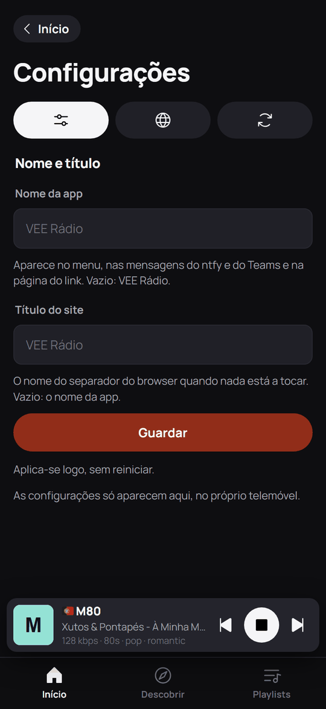
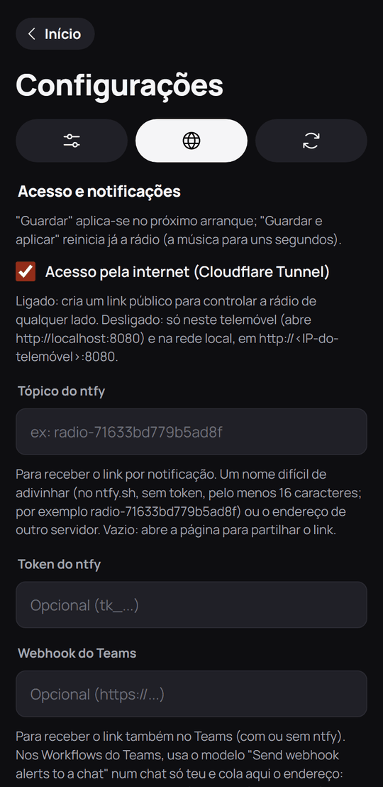
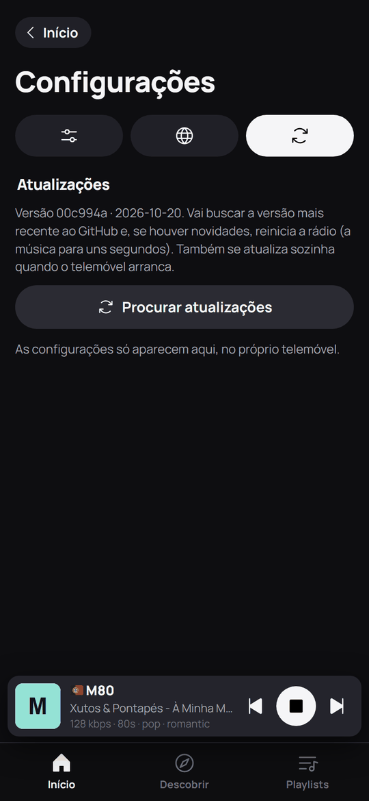
</p>

| Separador | O que muda |
| --- | --- |
| **Geral** | O nome da app (no menu, nas notificações e na página do link) e o título do separador do browser. Aplica-se logo |
| **Acesso** | O acesso pela internet (o link público), o tópico e o token do ntfy e o webhook do Teams |
| **Atualizações** | Mostra a versão instalada e procura uma mais recente |

No separador Acesso:

- **Guardar** aplica as mudanças no próximo arranque.
- **Guardar e aplicar agora** reinicia já a rádio. A música para uns segundos e, com o acesso pela internet ligado, chega um link novo.
- O token do ntfy e o webhook do Teams nunca aparecem depois de guardados. Deixar o campo vazio mantém o que lá está; para os apagar, usa a caixa **Remover**.

## 7. Parar, atualizar e cópias de segurança

### Parar a rádio

```bash
~/stop.sh
```

Para tudo: a música, o comando e o link.

### Atualizar

A rádio atualiza-se sozinha sempre que o telemóvel arranca. Para atualizar já, abre as Configurações → **Atualizações** e carrega em **Procurar atualizações**. Se houver uma versão nova, a rádio reinicia com ela e a música para uns segundos. No Termux, o mesmo é:

```bash
~/update.sh
```

Se uma versão nova não funcionar, a rádio volta sozinha à anterior.

### Cópias de segurança

Uma vez por dia, a rádio guarda uma cópia das playlists na pasta **Documents/vee-radio** do telemóvel e mantém as 7 mais recentes. Como ficam fora do Termux, sobrevivem mesmo que o desinstales.

```bash
~/backup.sh                     # faz uma cópia agora
~/backup.sh --repor             # repõe a cópia mais recente
~/backup.sh --repor <ficheiro>  # repõe uma cópia em particular
```

Antes de repor, a rádio guarda o estado atual numa cópia nova, para poderes voltar atrás.

As cópias não levam o token do ntfy, o webhook do Teams nem a chave das Configurações, porque outras apps conseguem ler essa pasta. Depois de reinstalar, volta a configurá-los.

## 8. Problemas comuns

| Problema | O que fazer |
| --- | --- |
| Não recebi o link | Confirma que o telemóvel da rádio tem internet. A rádio tenta outra vez sozinha e envia o link quando o conseguir criar. Para ver o que se passa, corre `cat ~/vigia.log` no Termux |
| O link antigo deixou de funcionar | É normal: o link muda sempre que a rádio arranca. Usa o mais recente |
| Aparece "Sem ligação ao telemóvel" | O telemóvel da rádio ficou sem internet, ou a rádio parou. Espera um minuto; se continuar, corre `~/start.sh` |
| Aparece "O MPD não está a responder" ou "MPD indisponível" | O programa que toca a música parou. Corre `~/start.sh` |
| A rádio para ao fim de algum tempo | O Android está a fechar o Termux. Desativa a otimização de bateria (ver [2.2](#22-arranque-automático)) e, no Android 12 ou mais recente, segue o [2.3](#23-android-12-ou-mais-recente-opcional) |
| Não arrancou sozinha depois de ligar o telemóvel | Confirma que abriste o Termux:Boot uma vez e que a otimização de bateria está desligada. O que aconteceu no arranque fica em `~/boot.log` |
| Uma rádio não toca | O endereço do stream pode ter mudado. Remove-a e procura-a outra vez em Descobrir, ou escolhe outra versão no reprodutor |
| Uma rádio aparece só com as iniciais | Não se encontrou logótipo. No reprodutor, usa **Mudar o logótipo** |
| Não vejo o botão ⚙ | As Configurações só aparecem no telemóvel da rádio. Corre `~/config.sh` no Termux |

## 9. Resumo dos comandos

Todos se escrevem no Termux, no telemóvel da rádio.

| Comando | Para quê |
| --- | --- |
| `~/start.sh` | Arrancar a rádio |
| `~/stop.sh` | Parar a rádio |
| `~/config.sh` | Abrir as Configurações no browser do telemóvel |
| `~/update.sh` | Atualizar já |
| `~/backup.sh` | Fazer uma cópia de segurança |
| `~/backup.sh --repor` | Repor a cópia mais recente |
| `cat ~/tunnel-url.txt` | Ver o link atual |
